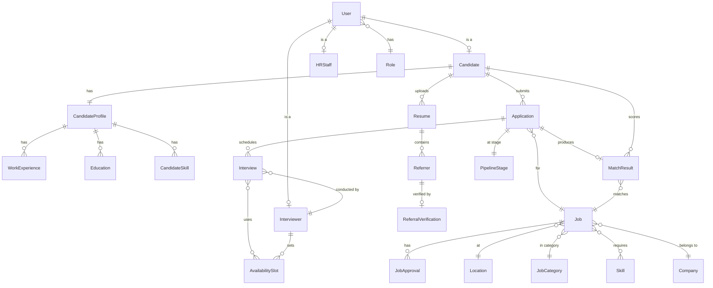
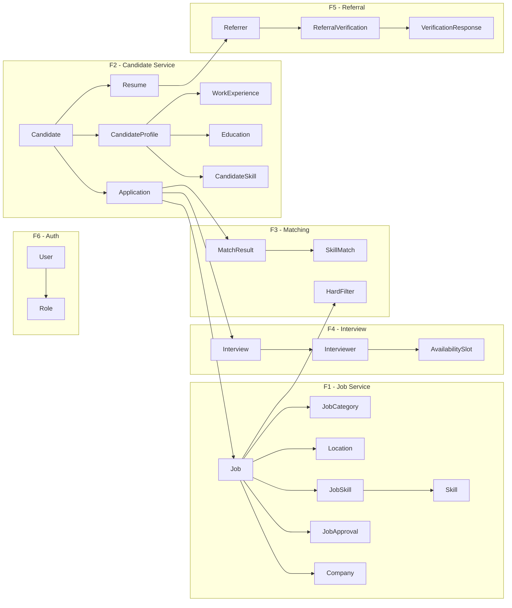
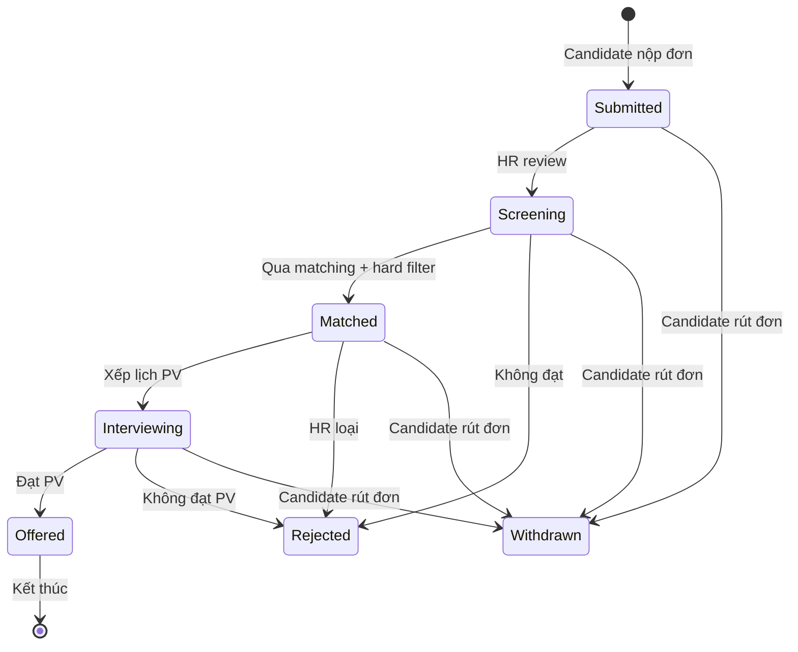

# 📋 Phân Tích Hệ Thống Tuyển Dụng Thông Minh — Nhóm 9

---

## 1. Tổng Quan Entity Map

---

## 2. Danh Sách Entity Theo Service

### F1 — Job Service

| Entity | Mô tả | Attributes chính |
|--------|--------|-----------------|
| **Job** | Tin tuyển dụng | `id`, `title`, `description`, `salaryMin`, `salaryMax`, `experienceYears`, `jobType` (Full-time/Part-time/Remote), `status` (Draft/PendingApproval/Active/Closed/Expired), `publishedAt`, `expiredAt`, `createdBy` |
| **JobCategory** | Ngành nghề | `id`, `name`, `parentId` (hỗ trợ phân cấp) |
| **Skill** | Kỹ năng yêu cầu | `id`, `name`, `category` |
| **JobSkill** | Bảng trung gian Job ↔ Skill | `jobId`, `skillId`, `level` (Required/Nice-to-have), `minYears` |
| **Location** | Địa điểm làm việc | `id`, `city`, `district`, `address` |
| **JobApproval** | Phê duyệt tin | `id`, `jobId`, `reviewerId`, `status` (Pending/Approved/Rejected), `comment`, `reviewedAt` |
| **Company** | Công ty đăng tuyển | `id`, `name`, `logo`, `industry`, `size`, `website` |

### F2 — Candidate Service

| Entity | Mô tả | Attributes chính |
|--------|--------|-----------------|
| **Candidate** | Ứng viên | `id`, `userId`, `profileId` |
| **CandidateProfile** | Hồ sơ cá nhân | `id`, `fullName`, `email`, `phone`, `dateOfBirth`, `address`, `summary` |
| **WorkExperience** | Kinh nghiệm làm việc | `id`, `profileId`, `company`, `position`, `startDate`, `endDate`, `description` |
| **Education** | Học vấn | `id`, `profileId`, `school`, `degree`, `major`, `startDate`, `endDate`, `gpa` |
| **CandidateSkill** | Kỹ năng ứng viên | `id`, `profileId`, `skillId`, `yearsOfExp`, `proficiency` |
| **Resume** | File CV | `id`, `candidateId`, `fileName`, `fileType` (PDF/DOCX), `fileUrl`, `uploadedAt`, `isPrimary` |
| **Application** | Đơn ứng tuyển | `id`, `candidateId`, `jobId`, `resumeId`, `status` (Submitted/Screening/Matched/Interviewing/Offered/Rejected/Withdrawn), `appliedAt` |
| **Notification** | Thông báo | `id`, `userId`, `type`, `title`, `content`, `isRead`, `createdAt` |

### F3 — Matching Service

| Entity | Mô tả | Attributes chính |
|--------|--------|-----------------|
| **MatchResult** | Kết quả so khớp | `id`, `applicationId`, `jobId`, `candidateId`, `overallScore`, `passedHardFilter`, `matchedAt` |
| **SkillMatch** | Chi tiết khớp kỹ năng | `id`, `matchResultId`, `skillId`, `requiredLevel`, `candidateLevel`, `score` |
| **HardFilter** | Bộ lọc cứng | `id`, `jobId`, `field` (experience/education/certification), `operator` (>=, ==), `value` |
| **ExtractedKeyword** | Từ khóa NLP | `id`, `sourceType` (JD/CV), `sourceId`, `keyword`, `category`, `confidence` |

### F4 — Interview Scheduler

| Entity | Mô tả | Attributes chính |
|--------|--------|-----------------|
| **Interviewer** | Người phỏng vấn | `id`, `userId`, `department`, `specialization` |
| **AvailabilitySlot** | Khung giờ rảnh | `id`, `userId`, `date`, `startTime`, `endTime`, `isBooked` |
| **Interview** | Buổi phỏng vấn | `id`, `applicationId`, `interviewerId`, `scheduledAt`, `duration`, `type` (Online/Onsite), `status` (Scheduled/Confirmed/Cancelled/Completed/Rescheduled), `meetingLink`, `notes` |
| **CalendarInvite** | Lời mời lịch | `id`, `interviewId`, `provider` (Google/Zoom), `externalEventId`, `inviteUrl` |

### F5 — Referral Verification Bot

| Entity | Mô tả | Attributes chính |
|--------|--------|-----------------|
| **Referrer** | Người tham chiếu | `id`, `resumeId`, `name`, `email`, `phone`, `company`, `relationship` |
| **ReferralVerification** | Xác thực tham chiếu | `id`, `referrerId`, `candidateId`, `status` (Pending/Verified/Suspicious/Expired), `verificationToken`, `sentAt`, `respondedAt` |
| **VerificationResponse** | Phản hồi xác thực | `id`, `verificationId`, `confirmedRelationship`, `confirmedPeriod`, `rating`, `comments` |

### F6 — Core / Cross-cutting

| Entity | Mô tả | Attributes chính |
|--------|--------|-----------------|
| **User** | Tài khoản hệ thống | `id`, `email`, `passwordHash`, `roleId`, `status` (Active/Inactive/Locked), `createdAt` |
| **Role** | Vai trò | `id`, `name` (Admin/Manager/HR/Candidate), `permissions[]` |
| **Permission** | Quyền hạn | `id`, `resource`, `action` (create/read/update/delete) |
| **PipelineStage** | Giai đoạn pipeline | `id`, `name` (Submitted/Matched/Interviewing/Offered), `order`, `color` |
| **AuditLog** | Nhật ký hệ thống | `id`, `userId`, `action`, `resource`, `resourceId`, `timestamp`, `details` |

---

## 3. Business Rules

### F1 — Job Service

| # | Rule |
|---|------|
| BR-1.1 | Job phải được **phê duyệt** (Approved) trước khi chuyển sang `Active` và hiển thị công khai |
| BR-1.2 | Job hết hạn (`expiredAt < now`) tự động chuyển sang `Expired`; HR có thể **gia hạn** (tạo mới `expiredAt`) |
| BR-1.3 | Chỉ Job có status `Active` mới xuất hiện trong kết quả tìm kiếm |
| BR-1.4 | Khi Job chuyển sang `Closed/Expired`, tất cả Application đang `Submitted` chuyển thành `Rejected` |
| BR-1.5 | `salaryMin <= salaryMax`; `experienceYears >= 0` |
| BR-1.6 | Một Job phải thuộc ít nhất **1 JobCategory** và **1 Location** |

### F2 — Candidate Service

| # | Rule |
|---|------|
| BR-2.1 | Mỗi Candidate chỉ được nộp **1 Application** cho cùng 1 Job đang Active |
| BR-2.2 | Resume chỉ chấp nhận file **PDF** hoặc **DOCX**, dung lượng tối đa **10 MB** |
| BR-2.3 | Candidate phải có ít nhất **1 Resume** để nộp đơn |
| BR-2.4 | Trạng thái Application chỉ chuyển **tiến** (Submitted → Screening → Matched → Interviewing → Offered) hoặc **loại** (→ Rejected/Withdrawn) — không quay ngược |
| BR-2.5 | Khi Application chuyển trạng thái → tự động gửi **Notification** cho Candidate |

### F3 — Matching Service

| # | Rule |
|---|------|
| BR-3.1 | **Hard Filter** chạy trước; nếu ứng viên không đạt BẤT KỲ tiêu chí nào → `passedHardFilter = false` → loại ngay |
| BR-3.2 | `overallScore` nằm trong khoảng **0–100** |
| BR-3.3 | Matching chỉ chạy cho Application ở trạng thái `Screening` |
| BR-3.4 | Kết quả xếp hạng sắp xếp **giảm dần** theo `overallScore`; HR xem danh sách top-down |
| BR-3.5 | Nếu `overallScore >= ngưỡng` (configurable) → tự động chuyển Application sang `Matched` |

### F4 — Interview Scheduler

| # | Rule |
|---|------|
| BR-4.1 | Lịch phỏng vấn chỉ được tạo khi Application ở trạng thái `Matched` hoặc `Interviewing` |
| BR-4.2 | Không được đặt lịch **trùng slot** đã booked của Interviewer hoặc Candidate |
| BR-4.3 | Hủy lịch phải thông báo **trước ít nhất 24h**; nếu không → cảnh báo |
| BR-4.4 | Mỗi Interview phải có **meeting link** nếu `type = Online` |
| BR-4.5 | Interview `Completed` → HR phải nhập **notes/feedback** trong vòng 48h |

### F5 — Referral Bot

| # | Rule |
|---|------|
| BR-5.1 | Verification token hết hạn sau **7 ngày** |
| BR-5.2 | Nếu Referrer không phản hồi sau 2 lần gửi email → status = `Expired` |
| BR-5.3 | Nếu thông tin Referrer phản hồi **mâu thuẫn** với CV → status = `Suspicious` |
| BR-5.4 | Mỗi Referrer chỉ xác thực **1 lần** cho mỗi Candidate |

### F6 — Cross-cutting

| # | Rule |
|---|------|
| BR-6.1 | Mọi request phải qua **API Gateway** và mang **JWT token** hợp lệ |
| BR-6.2 | **RBAC**: Admin (full quyền), Manager (quản lý Job + xem báo cáo), HR (CRUD Job + quản lý Application), Candidate (xem Job + nộp đơn + xem trạng thái) |
| BR-6.3 | Pipeline stage chỉ chuyển **tuần tự** theo thứ tự `order`; không nhảy bước |
| BR-6.4 | Mọi thao tác thay đổi dữ liệu phải ghi **AuditLog** |

---

## 4. Resources (REST API)

### F1 — Job Service

| Method | Resource | Mô tả |
|--------|----------|--------|
| POST | `/api/jobs` | Tạo tin tuyển dụng |
| GET | `/api/jobs` | Danh sách + tìm kiếm nâng cao |
| GET | `/api/jobs/{id}` | Chi tiết tin |
| PUT | `/api/jobs/{id}` | Cập nhật tin |
| DELETE | `/api/jobs/{id}` | Xóa tin |
| PATCH | `/api/jobs/{id}/close` | Đóng tin |
| PATCH | `/api/jobs/{id}/extend` | Gia hạn tin |
| POST | `/api/jobs/{id}/approvals` | Gửi yêu cầu duyệt |
| PATCH | `/api/jobs/{id}/approvals/{approvalId}` | Duyệt/Từ chối |
| GET | `/api/categories` | Danh mục ngành nghề |
| GET | `/api/skills` | Danh sách kỹ năng |
| GET | `/api/locations` | Danh sách địa điểm |

### F2 — Candidate Service

| Method | Resource | Mô tả |
|--------|----------|--------|
| GET/PUT | `/api/candidates/{id}/profile` | Xem/Cập nhật hồ sơ |
| CRUD | `/api/candidates/{id}/experiences` | Kinh nghiệm làm việc |
| CRUD | `/api/candidates/{id}/educations` | Học vấn |
| CRUD | `/api/candidates/{id}/skills` | Kỹ năng |
| POST | `/api/candidates/{id}/resumes` | Upload CV |
| GET | `/api/candidates/{id}/resumes` | Danh sách CV |
| GET | `/api/candidates/{id}/resumes/{rid}/preview` | Xem trước CV |
| POST | `/api/jobs/{jobId}/applications` | Nộp đơn ứng tuyển |
| GET | `/api/candidates/{id}/applications` | Lịch sử ứng tuyển |
| GET | `/api/applications/{id}` | Chi tiết đơn |
| PATCH | `/api/applications/{id}/status` | Cập nhật trạng thái |

### F3 — Matching Service

| Method | Resource | Mô tả |
|--------|----------|--------|
| POST | `/api/jobs/{jobId}/match` | Trigger matching cho Job |
| GET | `/api/jobs/{jobId}/match-results` | Kết quả xếp hạng |
| GET | `/api/applications/{id}/match-result` | Kết quả match của 1 đơn |
| CRUD | `/api/jobs/{jobId}/hard-filters` | Quản lý bộ lọc cứng |
| POST | `/internal/nlp/extract-keywords` | Trích xuất từ khóa (internal) |

### F4 — Interview Scheduler

| Method | Resource | Mô tả |
|--------|----------|--------|
| CRUD | `/api/users/{id}/availability` | Khung giờ rảnh |
| POST | `/api/applications/{id}/interviews` | Tạo lịch phỏng vấn |
| GET | `/api/interviews` | Danh sách phỏng vấn |
| PATCH | `/api/interviews/{id}/confirm` | Xác nhận |
| PATCH | `/api/interviews/{id}/cancel` | Hủy |
| PATCH | `/api/interviews/{id}/reschedule` | Dời lịch |
| POST | `/api/interviews/{id}/meeting-link` | Tạo link họp |

### F5 — Referral Bot

| Method | Resource | Mô tả |
|--------|----------|--------|
| POST | `/api/resumes/{id}/extract-referrers` | Bóc tách referrer từ CV |
| POST | `/api/referrers/{id}/verify` | Gửi email xác thực |
| GET | `/api/candidates/{id}/referral-status` | Trạng thái xác thực |
| POST | `/public/verification/{token}` | Form phản hồi (public) |

### F6 — Auth & Pipeline

| Method | Resource | Mô tả |
|--------|----------|--------|
| POST | `/api/auth/register` | Đăng ký |
| POST | `/api/auth/login` | Đăng nhập → JWT |
| POST | `/api/auth/refresh` | Refresh token |
| GET | `/api/users/me` | Thông tin user hiện tại |
| GET | `/api/jobs/{jobId}/pipeline` | Kanban pipeline |
| PATCH | `/api/applications/{id}/pipeline-stage` | Chuyển stage |

---

## 5. Mối Quan Hệ Giữa Các Entity

### Bảng tóm tắt quan hệ

| Quan hệ | Loại | Ghi chú |
|---------|------|---------|
| User → Role | N:1 | Mỗi user 1 role |
| Company → Job | 1:N | Công ty có nhiều tin |
| Job ↔ Skill | N:N | Qua bảng `JobSkill` |
| Job → JobCategory | N:1 | Mỗi tin thuộc 1 ngành |
| Job → Location | N:1 | Mỗi tin 1 địa điểm |
| Job → JobApproval | 1:N | Lịch sử duyệt |
| Candidate → CandidateProfile | 1:1 | Hồ sơ duy nhất |
| CandidateProfile → WorkExperience | 1:N | Nhiều kinh nghiệm |
| CandidateProfile → Education | 1:N | Nhiều bằng cấp |
| Candidate → Resume | 1:N | Nhiều CV |
| Candidate → Application | 1:N | Nhiều đơn |
| Application → Job | N:1 | Đơn cho 1 Job |
| Application → MatchResult | 1:1 | 1 kết quả match |
| MatchResult → SkillMatch | 1:N | Chi tiết từng skill |
| Application → Interview | 1:N | Nhiều vòng phỏng vấn |
| Interview → Interviewer | N:1 | 1 người phỏng vấn |
| Interviewer → AvailabilitySlot | 1:N | Nhiều slot rảnh |
| Resume → Referrer | 1:N | Nhiều người tham chiếu |
| Referrer → ReferralVerification | 1:1 | 1 lần xác thực/candidate |

---

## 6. Chức Năng Theo Service (CRUD + Business Operations)

### F1 — Job Service

| Chức năng | Entity tham gia | Loại |
|-----------|----------------|------|
| Tạo tin tuyển dụng | Job, JobSkill, HardFilter | CRUD |
| Sửa/Xóa tin | Job | CRUD |
| Đóng tin tuyển dụng | Job, Application | Business Op |
| Gia hạn tin | Job | Business Op |
| Duyệt tin | JobApproval, Job | Business Op |
| Tìm kiếm nâng cao | Job, Skill, Location, JobCategory | Query |
| Cung cấp data cho Matching | Job, JobSkill, HardFilter | Internal API |

### F2 — Candidate Service

| Chức năng | Entity tham gia | Loại |
|-----------|----------------|------|
| CRUD hồ sơ | CandidateProfile, WorkExperience, Education | CRUD |
| Upload/Quản lý CV | Resume | CRUD |
| Xem trước CV | Resume | Query |
| Nộp đơn ứng tuyển | Application, Resume | Business Op |
| Theo dõi trạng thái | Application | Query |
| Gửi thông báo realtime | Notification | Event-driven |

### F3 — Matching Service

| Chức năng | Entity tham gia | Loại |
|-----------|----------------|------|
| Trích xuất từ khóa NLP | ExtractedKeyword, Resume, Job | Processing |
| Chạy Hard Filter | HardFilter, CandidateProfile | Business Op |
| Tính điểm tương đồng | MatchResult, SkillMatch | Business Op |
| Xếp hạng ứng viên | MatchResult | Query |

### F4 — Interview Scheduler

| Chức năng | Entity tham gia | Loại |
|-----------|----------------|------|
| Thiết lập giờ rảnh | AvailabilitySlot | CRUD |
| Auto-schedule | AvailabilitySlot, Interview | Business Op |
| Xác nhận/Hủy/Dời lịch | Interview | Business Op |
| Tạo meeting link | CalendarInvite, Interview | Integration |

### F5 — Referral Bot

| Chức năng | Entity tham gia | Loại |
|-----------|----------------|------|
| Bóc tách referrer từ CV | Referrer, Resume | Processing |
| Gửi email xác thực | ReferralVerification | Business Op |
| Theo dõi trạng thái | ReferralVerification | Query |
| Nhận phản hồi | VerificationResponse | Business Op |

### F6 — Auth & Pipeline

| Chức năng | Entity tham gia | Loại |
|-----------|----------------|------|
| Đăng ký/Đăng nhập | User, Role | Auth |
| Phân quyền RBAC | Role, Permission | Auth |
| Kanban pipeline | Application, PipelineStage | Query |
| Chuyển stage | Application, PipelineStage | Business Op |
| Audit trail | AuditLog | Cross-cutting |

---

## 7. Application Status State Machine

---

> [!TIP]
> Tài liệu này là **baseline** để thiết kế database schema, API spec (OpenAPI), và phân chia microservice boundaries. Bước tiếp theo nên là vẽ **database schema chi tiết** hoặc viết **OpenAPI spec** cho từng service.
